# 🧊 Herdr Layout Gugugaga (Arctic Night Pixel Theme)

[English](README.en.md) | [简体中文](README.md)

**Turn your multi-agent terminal workspace into a living arctic pixel base.**

`layout-gugugaga` is a dedicated **Arctic Night Pixel** layout and theme pack for [Herdr](https://herdr.dev) Desktop. It pairs a deep, low-fatigue ice-blue palette (`gugugaga-ice`) with a complete **2D pixel-art overhaul**, turning every running AI agent into an animated *Gugugaga* penguin sprite—idle breathing, heads-down coding, or holding up a sign when blocked—complete with subagent squad trees, multi-machine space outliners, and native **Windows** & **macOS** support.


---

## ✨ Highlights & Pixel Gallery

- **🌌 `gugugaga-ice` Minimalist Arctic Night Theme**: Deep-sea navy/ice-blue base with high-contrast pixel status LEDs and golden active tab highlights designed for long coding sessions.
- **🐧 3-State Sprites & Tri-Partite Party Cards (`gugugaga-agents`)**: Includes 7 `256×256` pixel avatars and 21 `144×192` transparent 3-state GIFs; rebuilt inside a 320px sidebar as unified showcase cards separating **CLI Skin × Model Portrait × Runtime Status** across 9 CLIs / 10 sharp-corner pixel frame styles, 8 model-family half-body portraits, 9 `12×12` pixel vendor logos, and drag-to-reorder sorting.
- **🌿 Subagent Squad Pixel Tree**: Automatically detects subagents launched via `hc run` and attaches them under their parent card with 2D pixel trunk lines (up to 3 indentation depths) and collapsible count badges (`▾/▸ N`).
- **🏰 Arctic Landmarks & Space Outliner (`gugugaga-spaces`)**: 4 pixel-outlined arctic buildings (`igloo`, `lighthouse`, `fishshop`, `iceberg`; 160×160 sources drawn at 42×42) with multi-machine outliner tree lines and fold controls.
- **🗂️ Full Pixel UI Sync (`gugugaga-tabs` / `gugugaga-toast` / `inbox`)**: Synced pixel tab bar, RPG plaque notification toasts (synced across all 9 CLI pixel badges, with one-click login command copy), and a cross-platform Inbox adapted for Windows (OneDrive-safe Desktop path & Recycle Bin).

### 🃏 Party Showcase Cards & Subagent Tree (v5 Live Captures)

| CLI Skins × Model Portraits × 4 States (`Claude / Codex / OpenCode / Gemini / Qwen / Kimi`) | Hermes / Gugugaga Fallback / Pi & 2-Level Subagent Tree |
| :---: | :---: |
|  | 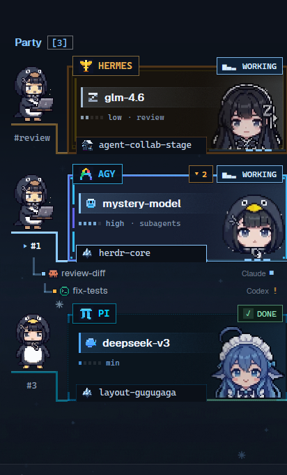 |

### 🐧 `gugugaga` 7-Character Avatar & 3-State Sprite Preview

| # | Avatar (`art/gugugaga`) | Rest (`~1.13 fps`) | Working (`~6.25 fps`) | Blocked (`~3.12 fps`) |
| :---: | :---: | :---: | :---: | :---: |
| 1 |  |  |  |  |
| 2 |  | 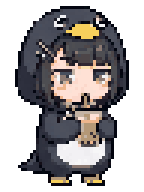 | 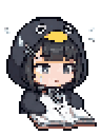 | 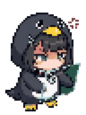 |
| 3 |  | 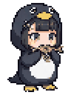 |  |  |
| 4 |  |  |  | 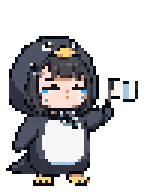 |
| 5 | 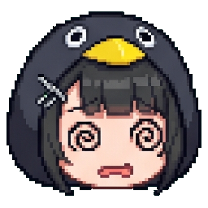 |  |  |  |
| 6 |  | 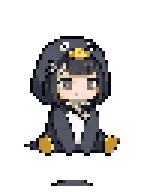 | 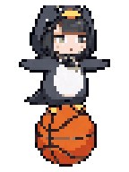 | 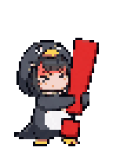 |
| 7 |  |  | 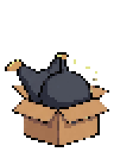 |  |

### 🏰 Arctic Space Landmarks (`gugugaga-spaces`)

| Igloo (`igloo`) | Lighthouse (`lighthouse`) | Fishshop (`fishshop`) | Iceberg (`iceberg`) |
| :---: | :---: | :---: | :---: |
|  |  | 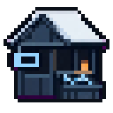 | 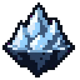 |

---

## 🚀 Quick Install

Copy `layouts`, `themes`, and `mods` into your Herdr config directory and switch to the `gugugaga` layout:

### Windows (PowerShell)

```powershell
$dest = "$env:USERPROFILE\.config\herdr-app"
New-Item -ItemType Directory -Force $dest | Out-Null
Copy-Item -Recurse -Force .\layouts, .\themes, .\mods $dest
herdr-app do layout.switch '{\"name\":\"gugugaga\"}'
```

### macOS / Linux (Bash)

```bash
DEST="$HOME/.config/herdr-app"
mkdir -p "$DEST" && cp -R ./layouts ./themes ./mods "$DEST/"
herdr-app do layout.switch '{"name":"gugugaga"}'
```

> **Shortcuts**: `Ctrl + Shift + L` cycles layouts; `Ctrl + Alt + Shift + Esc` returns to the default `main` layout.

---

## 📅 Changelog

### `2026-11-20`
- **320px sidebar width**: Widened the sidebar from 268px to 320px across `layouts/gugugaga.json` and `gugugaga-chrome`, and increased space-name max widths in `gugugaga-spaces` for cleaner truncation.
- **Party showcase card overhaul (v5 final, `gugugaga-agents`)**: Replaced the legacy 64px staggered two-lane cards with unified showcase cards separating **CLI Skin × Model Portrait × Runtime Status**:
  - **9 CLIs / 10 sharp-corner pixel frame styles** (`ring` / `dashed` / `double` / `ornate` / `solid` / `hairline`): dimmed default states by ~35%–45% so `Focused` and `Blocked` cards pop cleanly on scan;
  - **8 model-family portraits & 9 `12×12` pixel vendor logos** (`art/models/*.png`, `art/vendors/*.svg`): added unified deep-night `IDLE` scrim, widened left-feather text scrim, 5px portrait drop + top vignette to clear riding badges, and the `gugugaga.png` penguin portrait as the unknown-model fallback;
  - **Refined card layout & step rail**: moved reasoning Effort below the model banner (5-cell `3×4` pixel meter + subtle label + optional custom session subtitle), embedded the arctic space landmark into a flush bottom-edge notch, and connected the left penguin sprite via a `━━┓┗━━` step rail and frameless `#Tab`;
  - **Interactions & deeper subagent tree**: added left-drag card reordering (`localStorage` key `agents.order`) and expanded the subagent squad tree up to 3 indentation depths.
- **Synced 9-CLI pixel badges**: Updated `gugugaga-tabs` and `gugugaga-toast` `APPS` tables with `Hermes`, `Qwen`, and `Kimi` plus aligned brand colors across all 9 CLIs.

### `2026-11-18`
- **Standalone `layout-gugugaga` repository**: Slimmed down legacy assets into a focused Arctic Night Pixel theme pack with unified `gugugaga-*` mod naming.
- **`gugugaga-ice` theme & 3-state sprite pool**: Shipped 7 `256×256` avatars and 21 `144×192` 3-state GIFs (`r` rest / `w` working / `b` blocked) with live folder watching and per-terminal/tab caching.
- **Staggered party cards & subagent squad tree (`gugugaga-agents`)**: Automatic 2-lane staggering for ≥3 cards, collapsible 2D pixel subagent trees for `hc run` workers, 7 pixel agent crests (Antigravity / Pi / Claude / Codex / OpenCode / Gemini / generic), and live terminal model/effort parsing.
- **Space outliner & arctic landmarks (`gugugaga-spaces`)**: 4 pixel-outlined arctic buildings, multi-machine outliner tree lines with fold toggles & counts, and Herdr `0.1.21` local `space.new` compatibility.
- **Pixel tabs & RPG notification toasts (`gugugaga-tabs` / `gugugaga-toast`)**: 40×40 character portraits plus 16×16 agent crests and status pills in the tab bar, plus RPG plaque toasts with breadcrumbs and one-click `hc machine login` copy.
- **Native Windows Inbox (`inbox`)**: OneDrive-safe Desktop detection, collision-safe file copy, and Recycle Bin deletion while preserving macOS support.
- **Herdr gallery listing (this change)**: Added `RECIPE.md` (the build brief) and `preview.png` (the 1440×900 cover, machine names redacted); rebuilt `layouts/gugugaga.png` and `preview-gugugaga.png` so the old screenshots stop leaking a remote machine name and a local path; fixed three icon paths in `gugugaga-spaces` that still pointed at `mods/workspace-chrome/` instead of this repo's `mods/gugugaga-chrome/`.

---

## 🤖 AI Agent Maintenance & Extension Guide

If you are an AI Agent maintaining, debugging, or extending this repository, follow these conventions and verification steps:

### 1. Repository Structure

```text
layout-gugugaga/
├── README.md                    # Chinese guide (this file: README.en.md)
├── RECIPE.md                    # gallery brief: what you see / how it behaves / what it is built from / pitfalls
├── preview.png                  # gallery card cover (1440×900)
├── layouts/
│   ├── gugugaga.json            # Main layout (wires gugugaga-ice theme and mod slots)
│   ├── gugugaga.png             # Layout picker thumbnail
│   ├── preview-gugugaga.png     # README hero screenshot
│   ├── preview-party-cards.png  # Party CLI skins × model portraits overview
│   └── preview-party-subagents.png # Party Hermes / fallback penguin / subagent tree preview
├── themes/
│   └── gugugaga-ice.json        # Arctic Night color palette
└── mods/
    ├── gugugaga-chrome/         # Sidebar frame, background (sidebar-gugugaga.png), and pixel UI icons
    ├── gugugaga-spaces/         # Top-left: machine outliner tree + 4 arctic landmarks (art/gugugaga/*.png)
    ├── gugugaga-agents/         # Bottom-left: tri-partite showcase cards, 3-level subagent tree, 9 CLI skins, 8 model portraits & 3-state sprites
    ├── gugugaga-tabs/           # Top bar: pixel workspace tabs (9 CLI badges) and custom window controls
    ├── gugugaga-toast/          # Overlay: RPG plaque notification toast (9 CLI badges)
    └── inbox/                   # Drawer: cross-platform (Windows / macOS) file inbox
```

### 2. Sync & `herdr-app` Verification Loop

After editing files in this repo, sync `layouts/`, `themes/`, and `mods/` to the local Herdr config directory (`$env:USERPROFILE\.config\herdr-app` on Windows, `$HOME/.config/herdr-app` on macOS), then run:

```bash
# 1) Static & load check for each modified mod
herdr-app check ~/.config/herdr-app/mods/gugugaga-agents

# 2) Runtime status check: confirm layout is "gugugaga" and "errors" is []
herdr-app status

# 3) Visual verification screenshot
herdr-app shot
```

> **Note**: All `mods/*/lib.js` files are pure JS modules with no `gpui-kit` dependency and can be unit-tested directly via `node`.

### 3. Optional Local Overrides (Ignored by Git)

The following two mapping files are listed in `.gitignore` as **optional local overrides—do not commit them**:
- `mods/gugugaga-agents/jobs.json`: Tab name → character pool (e.g., `{"main": "gugugaga"}`).
- `mods/gugugaga-spaces/places.json`: Space name → landmark (`igloo` / `lighthouse` / `fishshop` / `iceberg`).

**Fallback behavior**: When missing, empty, or invalid JSON, mods deterministically assign characters and landmarks by name hash.

### 4. Adding Custom 3-State Character GIFs

1. **Add assets**:
   - Place `256×256` transparent PNG avatars in `mods/gugugaga-agents/art/<job>/`.
   - Place `144×192` transparent 3-state GIFs (`disposal=2, loop=0`) in `mods/gugugaga-agents/sprites/<job>/{r,w,b}/` (`r` = rest, `w` = working, `b` = blocked).
2. **Register pool**:
   - Adding files to the existing `gugugaga` folders requires no code changes (`watchFolder` + `readdir` hot-reloads automatically).
   - For a new `<job>` name, add `"<job>"` to `JOBS` and wire `portraitPath()` / `spritePath()` in `mods/gugugaga-agents/lib.js`, `mods/gugugaga-tabs/lib.js`, and `mods/gugugaga-toast/lib.js`, plus directory scanning in each `main.js`.
3. **Sync & verify**: Copy `mods/` to `.config/herdr-app/mods` and verify with `herdr-app check` and `herdr-app shot`.

---

## 🌐 Share on the Herdr Gallery

This repo also follows the Herdr gallery layout ([herdr.dev/gallery](https://herdr.dev/gallery/?type=layouts)):

- `RECIPE.md`: the brief another agent could rebuild this layout from, starting in an empty folder.
- `preview.png`: the gallery card cover (1440×900, whole window, machine names redacted); the thumbnail in Herdr's layout picker is `layouts/gugugaga.png` instead (the same view, captured at full resolution).
- How it gets listed: a **public** repo with the topic `herdr-layout` shows up under Community within the hour. No form, no sign up; Herdr does not review the code, only screens the cover pictures.

Once listed, the entry lives at `herdr.dev/layouts/Reidouleidoi/layout-gugugaga`, and installing it is one sentence to your agent:

```text
Read ~/.config/herdr-app/AGENTS.md, then add this layout: herdr.dev/layouts/Reidouleidoi/layout-gugugaga
```

**Known limit**: whether the sidebar counts as collapsed is decided by its width (< 160px). On macOS, collapsing it to 76px hides the chrome mod's toggle and the sidebar is not resizable, so there is no way back yet — don't collapse it there. Windows is unaffected.

---

## 🙏 Credits & License Notes

1. **Credits**: Derived from [`herdr-traveler`](https://github.com/franky5440-afk/herdr-traveler) by [@franky5440-afk](https://github.com/franky5440-afk), built for [Herdr](https://herdr.dev). Huge thanks to the original author for the pixel RPG terminal workbench concept!
2. **Assets & Licensing**: This repository distributes only the redrawn `gugugaga` arctic pixel assets and adapted code. Because the upstream repository does not include an explicit `LICENSE` file, this repository likewise does not add a third-party license and is shared for personal/community adaptation only. Contact the original author for commercial use or redistribution of original designs.
