# 🐧 Herdr Layout Gugugaga (Obsidian Pixel Deck)

[English](README.en.md) | [简体中文](README.md)

**Rebuild your multi-agent terminal workspace into a sharp, zero-radius Obsidian Pixel Deck.**

`layout-gugugaga` is an **Obsidian Pixel Deck** layout, theme, and 8-mod suite for [Herdr](https://herdr.dev) Desktop. Built on a neutral charcoal-obsidian skeleton (`#07090d` / `#0b0e14` / `#10141c`) with crisp `rounded(0)` pixel frames, electric cyan focus accents (`#38bdf8`), and strictly reserved amber alerts (`#ffb547`), it pairs animated *Gugugaga* penguin sprites with **10 CLI frame skins × 8 model-family portraits**, **4-tier responsive sidebar shrinking**, a **custom `28px` split-terminal header**, and an integrated **`Files` / `Changes` / `Inbox`** side drawer. Windows-first, macOS-aware.

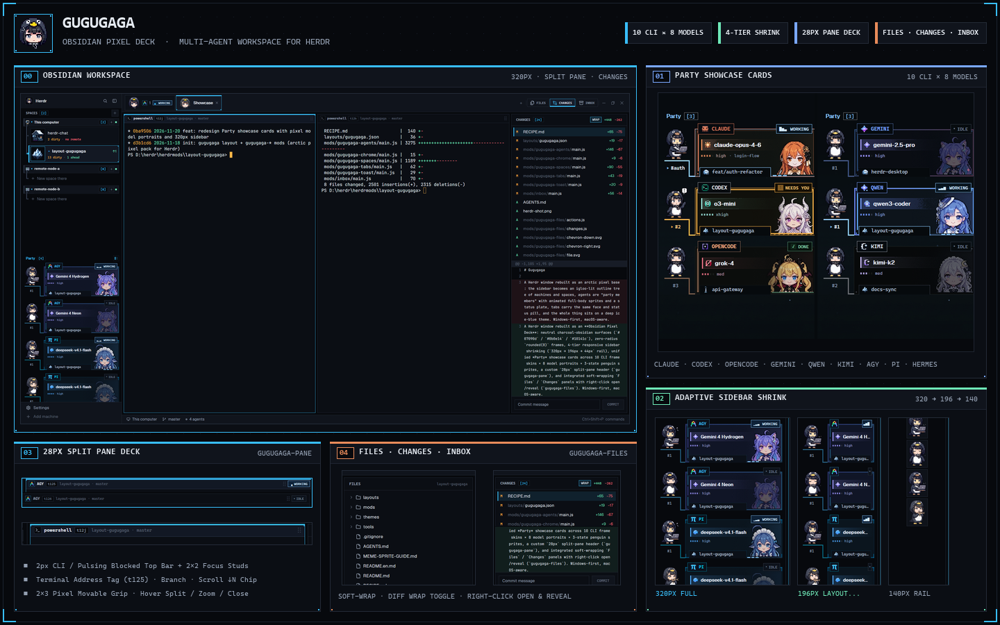

> 🤖 **AI Agent Entry Point**: If you are a coding agent maintaining or extending this repository, read [**`AGENTS.md`**](AGENTS.md) first—it indexes every mod, symbol anchor, design invariant, known gotcha, and verification command so you never need to grep the whole repo.

---

## ✨ Highlights & Pixel Gallery

- **🖤 `gugugaga-obsidian` Theme**: Deep charcoal-obsidian surfaces (`#07090d` / `#0b0e14` / `#10141c`), `rounded(0)` geometry everywhere, neutral graphite outliner trees (`#232a36`), `#38bdf8` reserved for focused/working states, and `#ffb547` strictly reserved for `NEEDS YOU / blocked` alerts. Legacy `themes/gugugaga-ice.json` remains intact for backward compatibility.
- **↔️ 4-Tier Responsive Sidebar Shrinking (`320px → 250px → 196px → 44px`)**: Drag the sidebar edge (`resizable: true`) or click the `[||]` quick toggle in `Party [n]` to snap between `320px ↔ 196px`:
  - `≥ 272px`: Full showcase card (`48×64` penguin + `112×90` model portrait);
  - `228–272px`: Cleanly collapses the right portrait once past its left divider—never slicing characters in half;
  - `160–228px`: Compact nameplate shrinking down to `layout…` in the bottom notch, with automatic icon-only status/CLI badge fallbacks; `Spaces` synchronously shrinks building tiles (`46→34px`) and hides per-machine `+`;
  - `< 160px`: Unified icon rail while preserving crisp integer scaling on `48×64` penguin GIFs.
- **🐧 10 CLI Frame Skins × 8 Model Portraits (`gugugaga-agents`)**: Distinct sharp-corner frames for Antigravity, Pi, Claude, Codex, OpenCode, Gemini, Hermes, Qwen, Kimi, plus fallback; supports drag-to-reorder (`agents.order`) and 3-level subagent squad trees.
- **🖥️ `28px` Split Terminal Deck (`gugugaga-pane`)**: Tops every split terminal pane with a `2px` CLI/blocked semantic bar, `2×2` focus corner studs, `16×16` CLI slot, `t125` terminal address tag, compact last-folder + branch label, non-intercepting `2×3` pixel grip, `↓N` scroll-bottom chip, `STATUS_SKIN` pill, `[Z]` zoom tag, and `20×20` hover split/zoom/close buttons inside a `6px` `radius: 0` grid.
- **📂 Integrated Drawer (`gugugaga-files` + `inbox`)**: Merged from `files-and-changes-addon` (derived from Herdr 0.1.16 `Apache-2.0`), adding soft-wrapping `Files` previews, zoom-corrected `Changes` diff wrapping with a persistent `WRAP` toggle & `COMMIT` button, and a keyboard-navigable (`↑/↓/Enter/Esc`) `frame: "none"` `rounded(0)` context menu (`Open with default app` / `Open folder` / `Reveal in File Explorer`), pixel-aligned (`h(36)` + `1px #232a36` border) with `inbox`.
- **🗂️ Synced Chrome (`gugugaga-tabs` / `gugugaga-spaces` / `gugugaga-toast` / `gugugaga-chrome`)**: `Cascadia Mono` uppercase status badges across tabs and toasts, partitioned `+ | FILES · CHANGES · INBOX | - □ ×` top-right controls using `14×14` monochrome SVGs, and solid-obsidian chrome.

### 🖥️ Full Workspace & 4-Tier Adaptive Shrinking

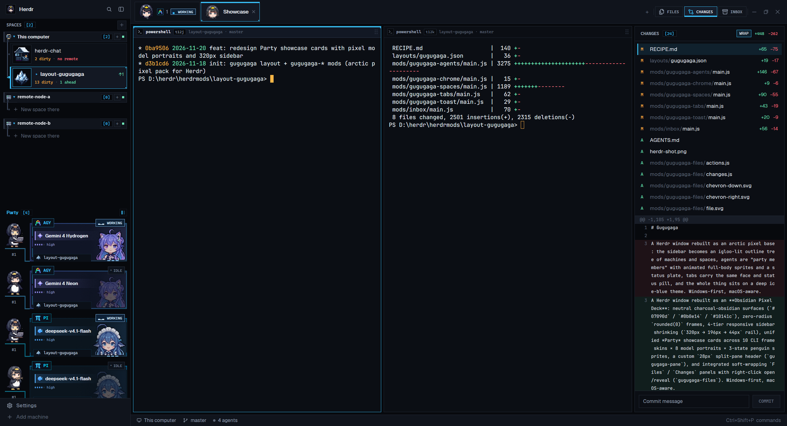

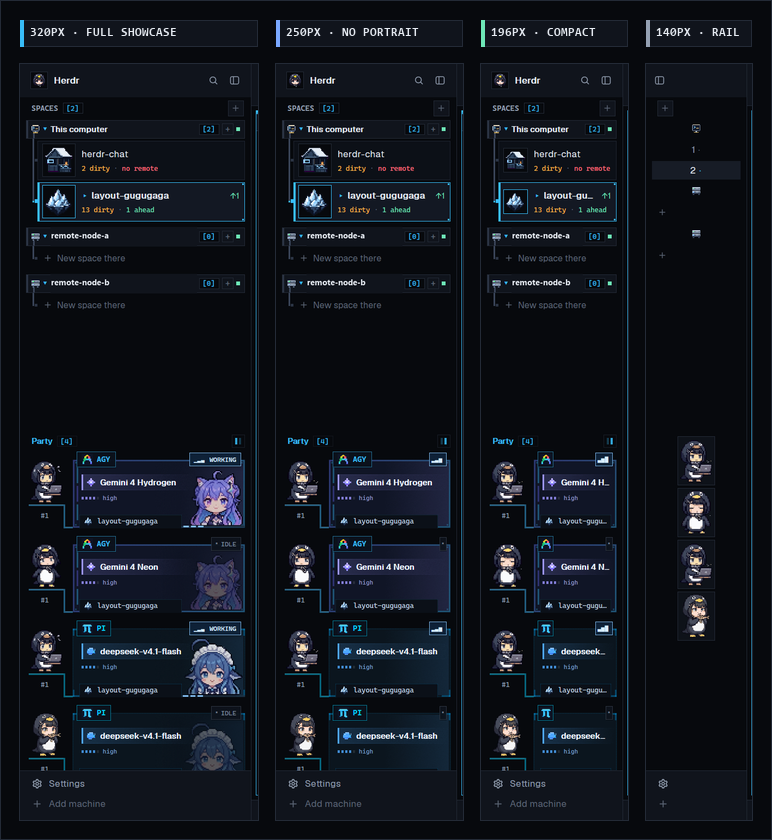

### 🃏 Party Showcase Cards & Subagent Tree

| CLI Skins × Model Portraits × 4 States (`Claude / Codex / OpenCode / Gemini / Qwen / Kimi`) | Hermes / Gugugaga Fallback / Pi & 2-Level Subagent Tree |
| :---: | :---: |
| 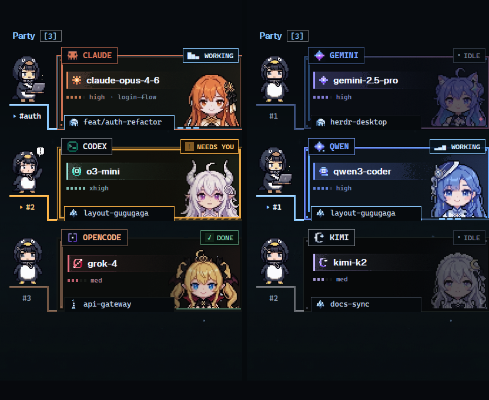 |  |

### 🐧 `gugugaga` 7-Character Avatar & 3-State Sprite Pool

| # | Avatar (`art/gugugaga`) | Rest (`~1.13 fps`) | Working (`~6.25 fps`) | Blocked (`~3.12 fps`) |
| :---: | :---: | :---: | :---: | :---: |
| 1 | 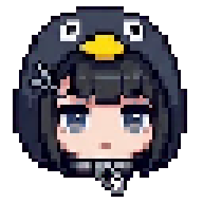 | 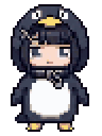 |  | 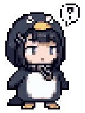 |
| 2 |  |  |  |  |
| 3 |  |  | 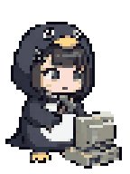 | 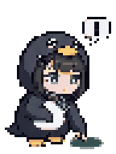 |
| 4 |  | 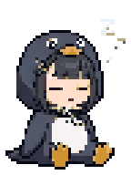 | 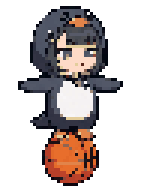 |  |
| 5 |  | 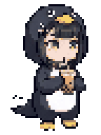 | 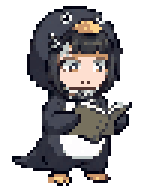 | 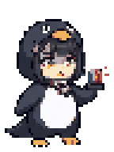 |
| 6 |  |  |  |  |
| 7 |  |  |  | 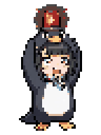 |

### 🏰 Pixel Space Landmarks (`gugugaga-spaces`)

| Igloo (`igloo`) | Lighthouse (`lighthouse`) | Fishshop (`fishshop`) | Iceberg (`iceberg`) |
| :---: | :---: | :---: | :---: |
| 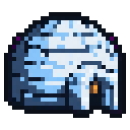 |  |  |  |

---

## 🚀 Quick Install

Copy `layouts`, `themes`, and `mods` into your Herdr config directory and switch to the `gugugaga` layout:

### Windows (PowerShell)

```powershell
$dest = "$env:USERPROFILE\.config\herdr-app"
New-Item -ItemType Directory -Force $dest | Out-Null
Copy-Item -Recurse -Force .\layouts, .\themes, .\mods $dest
herdr-app do layout.switch --name gugugaga
```

### macOS / Linux (Bash)

```bash
DEST="$HOME/.config/herdr-app"
mkdir -p "$DEST" && cp -R ./layouts ./themes ./mods "$DEST/"
herdr-app do layout.switch --name gugugaga
```

> **Shortcuts**: `Ctrl + Shift + L` cycles layouts; `Ctrl + Alt + Shift + Esc` returns to the default `main` layout.

---

## 📅 Changelog

### `2026-11-20` (Obsidian Pixel Deck Overhaul + Split Pane Deck + `gugugaga-files`)
- **Obsidian Pixel Deck global redesign**: Added `themes/gugugaga-obsidian.json` (keeping `gugugaga-ice.json` for compatibility), removed the snowy `sidebar-gugugaga.png` wallpaper, and unified all 8 mods around `rounded(0)` sharp geometry, neutral `#232a36` borders/outliner trunks, `#38bdf8` focus/working accent, and `Cascadia Mono` uppercase badges.
- **Resizable sidebar & 4-tier responsive shrink (`gugugaga-agents` / `gugugaga-spaces`)**: Enabled `sidebar.resizable: true`, divided `on_size_change` measurements by `settings().zoom`, implemented `320 → 250 → 196 (layout…) → <160 (rail)` shrinking with badge collision guards and a `320 ↔ 196` quick toggle in `Party [n]`, and unified the `< 160px` rail threshold.
- **`28px` custom split-pane header (`gugugaga-pane`)**: Switched `work-body` and `pane` to a `6px` `radius: 0` grid topped by a `28px` header featuring a `2px` CLI/blocked top bar, `2×2` focus corner studs, `16×16` CLI badge, `t1xx` terminal address tag, compact folder/branch, non-intercepting `2×3` movable grip, `↓N` scroll-bottom chip, `[Z]` zoom tag, and `20×20` hover actions.
- **Integrated `gugugaga-files` (from `files-and-changes-addon`)**: Merged soft-wrapping `Files` & `Changes` (with zoom-corrected diff wrap, persistent `WRAP` toggle, `t.accent` `COMMIT`, and keyboard-navigable `frame: "none"` right-click open/reveal menu) into `mods/gugugaga-files/`, pixel-aligned (`h(36)`, `1px` border) with `mods/inbox/`.
- **Tabs, Poster & AI Entry Index**: Rebuilt top-right drawer controls as `+ | FILES · CHANGES · INBOX | - □ ×` using `14×14` monochrome SVGs; produced the `1440×900` Bento gallery poster (`preview.png`), redacted full/shrink captures, updated `RECIPE.md`, and added `AGENTS.md`.
- **Party showcase foundation**: Upgraded the legacy staggered 64px cards to unified 320px showcase cards (10 CLI skins × 8 model portraits × 3-level subagent trees).

### `2026-11-18`
- **Standalone `layout-gugugaga` repository**: Shipped the 3-state penguin sprite pool (7 `256×256` avatars + 21 `144×192` GIFs), 4 space landmarks, cross-platform Windows/macOS `inbox`, and initial gallery `RECIPE.md` / `preview.png`.

---

## 🤖 AI Entry Point & Repository Structure

For detailed symbol anchors, color invariants, cross-mod sync checklists, and gotchas, see [**`AGENTS.md`**](AGENTS.md). Quick overview:

```text
layout-gugugaga/
├── AGENTS.md                        # AI entry index: anchors, palette invariants, sync rules & gotchas
├── README.md                        # Chinese guide (this file: README.en.md)
├── RECIPE.md                        # Herdr gallery rebuild brief
├── preview.png                      # Herdr gallery Bento poster (1440×900)
├── layouts/
│   ├── gugugaga.json                # Main layout (8-mod slots, 6px grid, resizable sidebar)
│   ├── gugugaga.png                 # Clean layout-picker thumbnail
│   ├── preview-gugugaga.png         # Full workspace screenshot
│   ├── preview-shrink-tiers.png     # 320→250→196→140 responsive shrink strip
│   ├── preview-party-cards.png      # Multi-CLI × model portrait cards
│   └── preview-party-subagents.png  # Hermes / fallback penguin / subagent tree
├── themes/
│   ├── gugugaga-obsidian.json       # Active Obsidian Pixel Deck theme
│   └── gugugaga-ice.json            # Legacy arctic theme (kept for compatibility)
└── mods/
    ├── gugugaga-chrome/             # Sidebar frame, collapse toggle & 30 monochrome SVGs
    ├── gugugaga-spaces/             # Machine outliner, git polling & adaptive landmark tiles
    ├── gugugaga-agents/             # 4-tier Party cards, 10 CLI skins, 8 model portraits & subagents
    ├── gugugaga-tabs/               # Sharp workspace tabs & partitioned FILES/CHANGES/INBOX buttons
    ├── gugugaga-pane/               # 28px split terminal header mod
    ├── gugugaga-files/              # Soft-wrapping Files & Changes + open/reveal menu (Apache-2.0 derived)
    ├── gugugaga-toast/              # Corner-studded pixel notification overlay
    └── inbox/                       # Cross-platform file inbox over data/inbox/files
```

Check all 8 mods and runtime status on Windows:

```powershell
foreach ($m in @("gugugaga-agents","gugugaga-spaces","gugugaga-tabs","gugugaga-toast","gugugaga-chrome","gugugaga-pane","gugugaga-files","inbox")) {
  herdr-app check "$env:USERPROFILE\.config\herdr-app\mods\$m"
}
herdr-app status
```

> Local overrides `mods/gugugaga-agents/jobs.json` and `mods/gugugaga-spaces/places.json` are listed in `.gitignore`; mods fall back deterministically by name hash when omitted.

---

## 🌐 Share on the Herdr Gallery

Maintained in [herdr.dev/gallery](https://herdr.dev/gallery/?type=layouts) format (`RECIPE.md`, `1440×900` Bento cover `preview.png`, and `layouts/gugugaga.png`). Once listed at `herdr.dev/layouts/Reidouleidoi/layout-gugugaga`, anyone can install it with:

```text
Read ~/.config/herdr-app/AGENTS.md, then add this layout: herdr.dev/layouts/Reidouleidoi/layout-gugugaga
```

---

## 🙏 Credits & License Notes

1. **`herdr-traveler`**: Initial pixel workbench structure and RPG party concept derived from [`herdr-traveler`](https://github.com/franky5440-afk/herdr-traveler) by [@franky5440-afk](https://github.com/franky5440-afk). Because the upstream repository has no explicit `LICENSE` file, this repository does not add a blanket third-party license.
2. **Herdr Upstream Components (`Apache-2.0`)**: `mods/gugugaga-files/` incorporates `files-and-changes-addon`, whose `Files` and `Changes` panels are cloned from [Herdr](https://herdr.dev) 0.1.16 (`Apache-2.0`, preserving upstream file headers); `mods/gugugaga-pane/` and `mods/gugugaga-chrome/` extend Herdr's built-in pane/chrome patterns.
3. **Original Assets & Redesign**: The `gugugaga` 3-state penguin sprites, space landmark pixel art, `gugugaga-obsidian` palette, and Obsidian Pixel Deck redesign are original to this repository.
