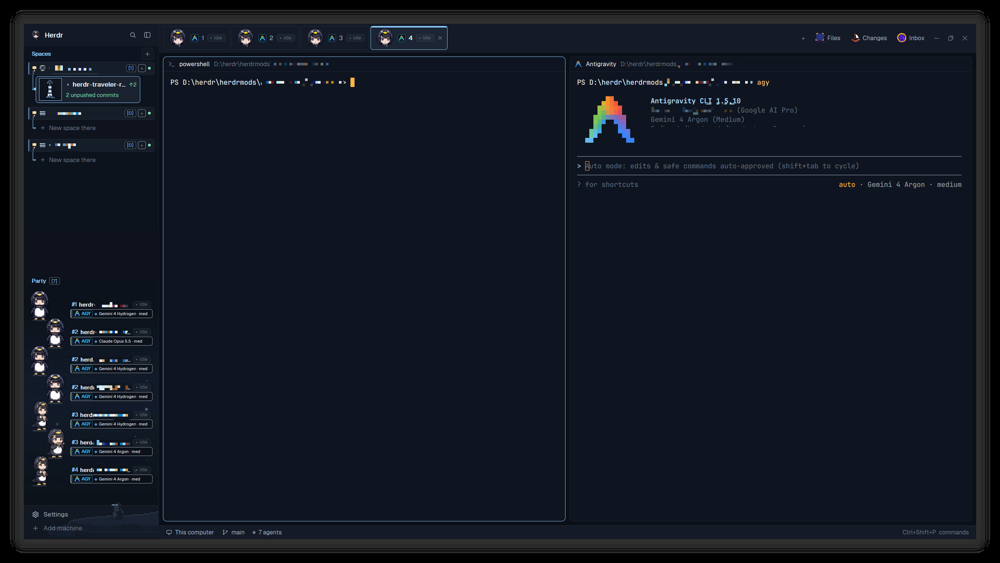
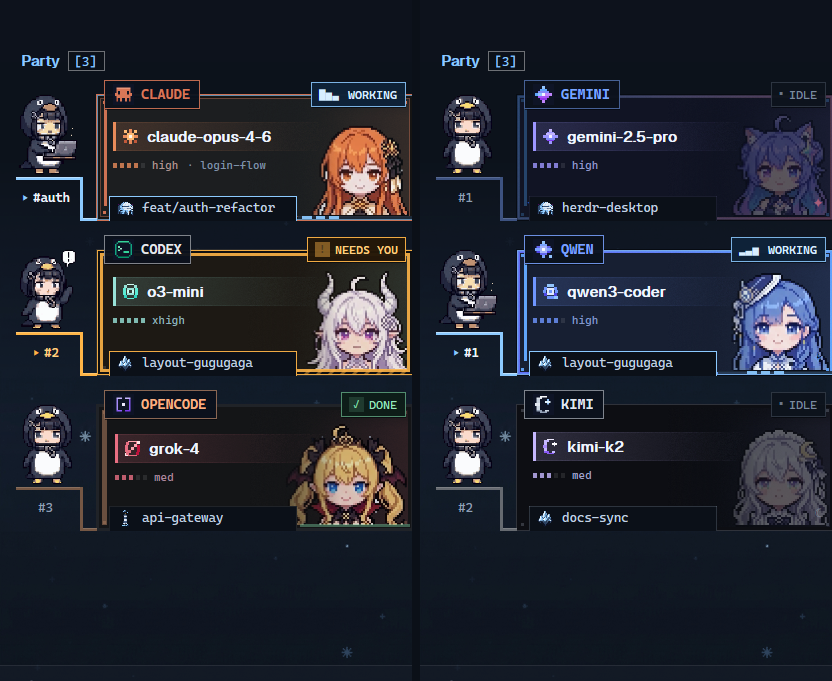
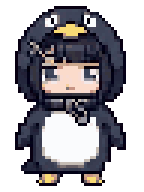
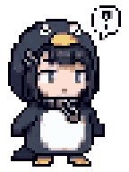
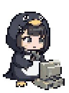
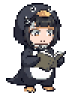
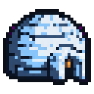

# 🧊 Herdr Layout Gugugaga（咕咕嘎嘎 · 冰夜像素风）

[简体中文](README.md) | [English](README.en.md)

**把你的多 Agent 终端工作台，变成一座运转不息的极地像素基地。**

`layout-gugugaga` 是专为 [Herdr](https://herdr.dev) 桌面端打造的 **「Gugugaga 冰夜像素风」** 布局与主题套装。深邃通透的极夜冰蓝配色（`gugugaga-ice`）搭配全套 **2D 像素视觉重绘**，让每一个运行中的 AI Agent 化身「咕咕嘎嘎」像素小人——待机呼吸、埋头苦干、举牌求救一目了然，子代理树形连线与多机空间大纲尽收眼底，原生支持 **Windows** 与 **macOS**。



---

## ✨ 主题亮点与像素图鉴

- **🌌 `gugugaga-ice` 极简现代冰夜主题**：低视觉疲劳的深海冰蓝基底，搭配高对比像素状态灯与金色选中高亮条，久看不累。
- **🐧 咕咕嘎嘎三态动态精灵与「三权分立」展示卡 (`gugugaga-agents`)**：内置 7 套 `256×256` 像素头像与 21 枚 `144×192` 三态透明 GIF；320px 宽侧栏下重绘为统一展示卡（**CLI 皮肤 × Model 立绘 × 运行状态**），涵盖 9 种 CLI / 10 套直角像素边框流派、8 大模型家族半身立绘与 9 枚 `12×12` 像素厂家 Logo，支持左键拖拽重排卡片。
- **🌿 子代理像素树形连线（小队梯）**：自动识别 `hc run` 启动的子代理，以 2D 像素树干与折叠徽章（`▾/▸ 数量`）挂载在父卡片下方（最多 3 层缩排），告别满屏卡片堆叠。
- **🏰 极地冰屋建筑与空间大纲树 (`gugugaga-spaces`)**：4 座像素描边极地建筑（冰屋 `igloo`、灯塔 `lighthouse`、鱼铺 `fishshop`、冰山 `iceberg`，源图 160×160、界面内渲染 42×42），配合多机器节点像素大纲树线与折叠控制。
- **🗂️ 全链路像素 UI 同步 (`gugugaga-tabs` / `gugugaga-toast` / `inbox`)**：顶部像素标签栏、RPG 铭牌通知弹窗（同步支持全部 9 种 CLI 像素徽章，支持一键复制登录命令），以及完整适配 Windows（兼容 OneDrive 桌面路径与回收站）的跨平台收件箱。

### 🃏 Party 展示卡总览与子代理树（v5 实机截图）

| CLI 皮肤 × 模型娘 × 四态组合总览 (`Claude / Codex / OpenCode / Gemini / Qwen / Kimi`) | Hermes / 咕咕嘎嘎兜底 / Pi 与 2 层子代理树 |
| :---: | :---: |
|  |  |

### 🐧 咕咕嘎嘎（`gugugaga`）全套 7 组三态动图与头像预览

| # | 像素头像 (`art/gugugaga`) | Rest 待机 (`~1.13 fps`) | Working 工作中 (`~6.25 fps`) | Blocked 等待确认 (`~3.12 fps`) |
| :---: | :---: | :---: | :---: | :---: |
| 1 |  |  |  |  |
| 2 |  |  |  |  |
| 3 |  |  |  |  |
| 4 |  |  |  |  |
| 5 |  |  |  |  |
| 6 |  |  |  |  |
| 7 |  |  |  |  |

### 🏰 极地空间像素建筑 (`gugugaga-spaces`)

| 冰屋 (`igloo`) | 灯塔 (`lighthouse`) | 鱼铺 (`fishshop`) | 冰山 (`iceberg`) |
| :---: | :---: | :---: | :---: |
|  |  |  |  |

---

## 🚀 一键安装与切换

将仓库中的 `layouts`、`themes`、`mods` 复制到 Herdr 配置目录，并执行切换命令即可生效：

### Windows (PowerShell)

```powershell
$dest = "$env:USERPROFILE\.config\herdr-app"
New-Item -ItemType Directory -Force $dest | Out-Null
Copy-Item -Recurse -Force .\layouts, .\themes, .\mods $dest
herdr-app do layout.switch '{\"name\":\"gugugaga\"}'
```

### macOS / Linux (Bash)

```bash
DEST="$HOME/.config/herdr-app"
mkdir -p "$DEST" && cp -R ./layouts ./themes ./mods "$DEST/"
herdr-app do layout.switch '{"name":"gugugaga"}'
```

> **快捷键提示**：`Ctrl + Shift + L` 循环切换布局；`Ctrl + Alt + Shift + Esc` 随时切回默认 `main` 布局。

---

## 📅 更新内容 (Changelog)

### `2026-11-20`
- **侧栏拓宽至 320px**：更新 `layouts/gugugaga.json` 与 `gugugaga-chrome` 折叠恢复默认宽度（268px → 320px），并放宽 `gugugaga-spaces` 空间名最大宽度，长名称显示更完整。
- **Party 展示卡重构（v5 定稿：`gugugaga-agents`）**：从旧版 64px 双列错位重构为统一展示卡，采用**「CLI 皮肤 × Model 立绘 × 运行状态」三权分立**设计：
  - **9 种 CLI / 10 套直角像素边框流派**（`ring` / `dashed` / `double` / `ornate` / `solid` / `hairline`）：Default 态分级压暗约 35%–45% 退居背景，`Focused` / `Blocked` 高对比跳脱；
  - **8 大模型家族立绘与 9 枚 `12×12` 像素厂家 Logo**（`art/models/*.png`、`art/vendors/*.svg`）：新增 `IDLE` 统一深冰夜压暗幕、加宽左向羽化 Scrim、立绘下移避让状态扣，并以咕咕嘎嘎企鹅妹（`gugugaga.png`）作为未知模型兜底立绘；
  - **信息层级与极简托架**：思考强度（Effort）独立移至模型名下方（5 格 `3×4` 像素刻度 + 低调等级字 + 可选自定义会话副标）；Space 极地建筑改为名片底边齐平方形挖槽；左侧企鹅改为脚底 `━━┓┗━━` 阶梯托架直连名片左下角 + 无框 `#Tab`；
  - **交互与子代理扩展**：支持左键拖拽重排卡片（`localStorage` 持久化 `agents.order`），子代理树扩展支持最多 3 层缩排。
- **全端 CLI 徽章同步**：`gugugaga-tabs` 与 `gugugaga-toast` 同步补齐并统一全部 9 种 CLI 像素徽章（含 `Hermes`、`Qwen`、`Kimi`）与配色。

### `2026-11-18`
- **独立为 `layout-gugugaga` 仓库**：精简剥离旧版冗余资源，聚焦「Gugugaga 冰夜像素风」单一完整主题包，全部组件统一命名为 `gugugaga-*`。
- **推出 `gugugaga-ice` 主题与全套三态像素池**：配套 7 张 `256×256` 透明头像与 21 个 `144×192` 三态 GIF（`r` 待机 / `w` 工作中 / `b` 阻塞），支持目录热监听与按终端/标签独立缓存。
- **双列错位队伍卡与子代理树形连线 (`gugugaga-agents`)**：≥3 张卡片自动左右错位防遮挡；支持 `hc run` 子代理以 2D 像素树形连线挂载在父卡片下并可折叠；内置 7 枚主流 Agent 像素徽章（Antigravity / Pi / Claude / Codex / OpenCode / Gemini 等）、终端实时模型抓取与低功耗帧动画优化。
- **空间大纲树与冰屋建筑 (`gugugaga-spaces`)**：重绘 4 座极地冰屋像素建筑，新增本地/远程机器 Outliner 像素树线、折叠箭头与数量徽章，并兼容 Herdr `0.1.21` 本机新建 Space 参数。
- **顶部像素标签与 RPG 弹窗 (`gugugaga-tabs` / `gugugaga-toast`)**：标签栏同步 40×40 角色头像与 16×16 Agent 品牌徽章，外加状态胶囊；通知弹窗采用像素角钉铭牌设计，支持面包屑定位与远程机器登录命令一键复制。
- **Windows 收件箱原生适配 (`inbox`)**：完整兼容 Windows 真实桌面路径识别（含 OneDrive）、防重名递增复制与移入 Windows 回收站，同时保留 macOS 支持。
- **Herdr 画廊收录（本次）**：新增 `RECIPE.md`（英文构建说明）与 `preview.png`（1440×900 封面，已打码机器名）；`layouts/gugugaga.png` 与 `preview-gugugaga.png` 同步重做，消除旧截图里泄漏的远程机器名与本地路径；修正 `gugugaga-spaces` 里三处指向旧 `mods/workspace-chrome/` 的图标路径，改为仓库自带的 `mods/gugugaga-chrome/`。

---

## 🤖 给 AI Agent 的维护与二次开发指引

如果你是负责维护、排错或扩展本仓库的 AI Agent，请遵循以下工程规范与校验工作流：

### 1. 目录结构

```text
layout-gugugaga/
├── README.md                    # 中文说明（英文版：README.en.md）
├── RECIPE.md                    # 画廊用构建说明：所见 / 行为 / 构建 / 坑
├── preview.png                  # 画廊卡片封面（1440×900）
├── layouts/
│   ├── gugugaga.json            # 主布局定义（引用 gugugaga-ice 主题与各槽位 mod）
│   ├── gugugaga.png             # 布局选择器缩略图
│   ├── preview-gugugaga.png     # README 主预览图
│   ├── preview-party-cards.png  # Party 多 CLI × 模型娘组合总览图
│   └── preview-party-subagents.png # Party Hermes / 兜底企鹅 / 子代理树预览图
├── themes/
│   └── gugugaga-ice.json        # 极简现代冰夜主题色板
└── mods/
    ├── gugugaga-chrome/         # 侧栏骨架、底图 (sidebar-gugugaga.png) 与通用像素图标
    ├── gugugaga-spaces/         # 左上：机器分组大纲树 + 4 座极地建筑 (art/gugugaga/*.png)
    ├── gugugaga-agents/         # 左下：三权分立展示卡、3 层子代理树、9 种 CLI 皮肤、8 模型立绘与三态精灵池
    ├── gugugaga-tabs/           # 顶部：像素风工作区标签栏（9 种 CLI 徽章）与自定义窗口控制键
    ├── gugugaga-toast/          # 浮层：RPG 像素铭牌通知弹窗（9 种 CLI 徽章）
    └── inbox/                   # 抽屉：跨平台（Windows / macOS）临时文件收件箱
```

### 2. 开发同步与 `herdr-app` 校验流程

修改本仓库代码后，需先同步到本机 Herdr 配置目录（Windows 为 `$env:USERPROFILE\.config\herdr-app`，macOS 为 `$HOME/.config/herdr-app`），随后按顺序执行以下命令做闭环验证：

```bash
# 1) 静态与加载检查：逐一确认每个 mod 的 JSON / JS 语法与槽位绑定无报错
herdr-app check ~/.config/herdr-app/mods/gugugaga-agents

# 2) 运行时状态检查：确认当前激活布局为 gugugaga，且无异常降级或崩溃状态
herdr-app status

# 3) 视觉截图验收：抓取当前 Herdr 窗口渲染结果，核对像素对齐、文字换行与状态配色
herdr-app shot
```

> **注意**：`mods/*/lib.js` 均为不依赖 `gpui-kit` 的纯函数模块，可在改动后直接通过 `node` 导入做单元测试。

### 3. 可选本地覆盖文件（不进 Git）

以下两个映射配置文件已在 `.gitignore` 中忽略，**属于用户可选的本地覆盖项，切勿提交到版本库**：
- `mods/gugugaga-agents/jobs.json`：分页/标签名称 → 角色名（如 `{"main": "gugugaga"}`）。
- `mods/gugugaga-spaces/places.json`：空间名称 → 建筑名（可选值：`igloo` / `lighthouse` / `fishshop` / `iceberg`）。

**容错机制**：当这两个文件缺失、为空或 JSON 非法时，模组会自动按名称哈希稳定分配角色与建筑，无需手动创建即可正常运行。

### 4. 如何扩展自定义角色三态 GIF

若需新增自定义角色 `<job>`（或向 `gugugaga` 池追加素材）：
1. **放置素材**：
   - 将 `256×256` 透明 PNG 头像放入 `mods/gugugaga-agents/art/<job>/`；
   - 将 `144×192` 三态透明 GIF（建议 `disposal=2, loop=0`）按状态分别放入：
     - `mods/gugugaga-agents/sprites/<job>/r/`（Rest 待机）
     - `mods/gugugaga-agents/sprites/<job>/w/`（Working 工作中）
     - `mods/gugugaga-agents/sprites/<job>/b/`（Blocked 等待确认）
2. **注册角色池**：
   - 若只是往现有 `gugugaga` 目录增删图片，无需改代码——`main.js` 中的 `watchFolder` + `readdir` 会自动热更新资源池并重置失效缓存；
   - 若是新增独立角色名 `<job>`，请同步编辑 `mods/gugugaga-agents/lib.js`、`mods/gugugaga-tabs/lib.js`、`mods/gugugaga-toast/lib.js` 三个文件：在 `JOBS` 数组中加入 `"<job>"`，在 `portraitPath()` / `spritePath()` 中接入对应资源池，并在各自的 `main.js` 中补充目录扫描或映射。
3. **同步并校验**：将 `mods/` 复制到 `.config/herdr-app/mods` 并运行 `herdr-app check` 与 `herdr-app shot` 验证渲染效果。

---

## 🌐 在 Herdr 画廊分享

本仓库同时按 Herdr 画廊（[herdr.dev/gallery](https://herdr.dev/gallery/?type=layouts)）的收录格式维护：

- `RECIPE.md`：给另一个 agent 的构建说明（它拿到空文件夹就能照着重做这套布局）。
- `preview.png`：画廊卡片封面（1440×900，整窗截图，机器名已打码）；Herdr 布局选择器里的缩略图另用 `layouts/gugugaga.png`（同一视角的高分屏截图）。
- 收录方式：仓库为 **Public** + 仓库 topic 加 `herdr-layout`，约一小时内自动出现在 Community 分类下（无需提交表单，Herdr 不做人工代码审核，仅审核封面图）。

收录后条目地址为 `herdr.dev/layouts/Reidouleidoi/layout-gugugaga`，别人只需对自己的 agent 说一句：

```text
Read ~/.config/herdr-app/AGENTS.md, then add this layout: herdr.dev/layouts/Reidouleidoi/layout-gugugaga
```

**已知限制**：侧栏折叠状态按宽度判定（< 160px）。在 macOS 上折叠到 76px 后，chrome 会隐藏折叠按钮且侧栏不可拖拽，目前没有展开入口，建议 macOS 用户不要折叠；Windows 下无此问题。

---

## 🙏 致谢与版权说明 (Credits)

1. **致谢原作者**：本项目衍生自 [@franky5440-afk](https://github.com/franky5440-afk) 创作的 [`herdr-traveler`](https://github.com/franky5440-afk/herdr-traveler)，宿主环境为 [Herdr](https://herdr.dev)（内置组件基于 Herdr 官方组件扩展改造）。感谢原作者极具创意的像素 RPG 终端工作台设计！
2. **资产与许可说明**：本仓库仅分发重绘与整理后的 `gugugaga` 冰夜像素素材及适配代码。因上游仓库未附带显式开源许可证（`LICENSE`），本仓库同样不擅自添加第三方许可证文件，仅作为社区自用适配与主题改造分享；如需商业使用或二次分发原版相关设计，请联系原作者获取授权。
