# 🐧 Herdr Layout Gugugaga（黑曜石像素机能台 · Obsidian Pixel Deck）

[简体中文](README.md) | [English](README.en.md)

**把你的多 Agent 分屏工作台，重构为一整套高密度、零圆角的黑曜石像素机能驾驶舱。**

`layout-gugugaga` 是专为 [Herdr](https://herdr.dev) 桌面端打造的 **Obsidian Pixel Deck** 布局、主题与 8-Mod 套装。以深炭黑曜石骨架（`#07090d` / `#0b0e14` / `#10141c`）搭配硬朗直角 `rounded(0)`、电青焦点光（`#38bdf8`）与独占告警琥珀（`#ffb547`），融合 *Gugugaga* 企鹅三态动态精灵、**10 套 CLI 外框皮肤 × 8 大模型家族半身立绘**、**4 档侧栏自适应收缩**、**28px 自定义分屏终端顶栏**，以及整合软换行与右键定位能力的 **`Files` / `Changes` / `Inbox`** 右侧抽屉，原生支持 **Windows** 与 **macOS**。

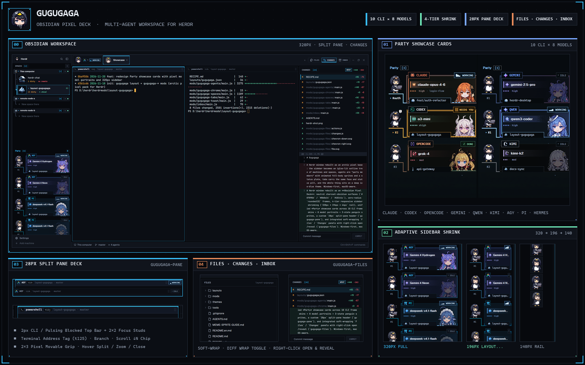

> 🤖 **AI 开发者入口**：如果你是负责修改或维护本仓库的 Coding Agent，请直接先阅读根目录的 [**`AGENTS.md`**](AGENTS.md)（包含 8 个 Mod 的代码锚点、设计铁律、已知坑与一键校验命令，无需全量 grep 仓库）。

---

## ✨ 核心特性与实机图鉴

- **🖤 `gugugaga-obsidian` 黑曜石像素主题**：以 `#07090d` / `#0b0e14` / `#10141c` 炭黑为主调，全站严格 `rounded(0)` 零圆角、中性炭灰树干与边框（`#232a36`），`#38bdf8` 仅点亮聚焦/工作态，`#ffb547` 严格独占 `NEEDS YOU / blocked` 告警信号；另保留旧版 `themes/gugugaga-ice.json` 兼容老配置。
- **↔️ 4 档侧栏自适应收缩 (`320px → 250px → 196px → 44px`)**：支持直接拖拽侧栏边界或点击 `Party [n]` 右侧 `[||]` 像素按钮一键在 `320 ↔ 196` 之间切换：
  - `≥ 272px`：完整展示卡（左侧 `48×64` 企鹅 + 右侧 `112×90` 模型立绘）；
  - `228–272px`：越过立绘左边界线后整块收起右侧立绘（绝不半切人物）；
  - `160–228px`：极简铭牌态，压窄至底槽仅露出 `layout…`，并自动切换纯符号状态扣 / 纯 Logo CLI 扣防止顶栏撞车；`Spaces` 同步缩窄建筑槽（`46→34px`）并隐藏机器行 `+`；
  - `< 160px`：统一切换至紧凑像素图标轨（保持企鹅 GIF `48×64` 整数倍锐利渲染）。
- **🐧 10 套 CLI 皮肤 × 8 大模型立绘 (`gugugaga-agents`)**：支持 Antigravity、Pi、Claude、Codex、OpenCode、Gemini、Hermes、Qwen、Kimi 与通用 Agent 兜底；支持左键拖拽重排卡片（持久化 `agents.order`）与最多 3 层缩排的子代理像素树。
- **🖥️ 28px 分屏终端机能顶栏 (`gugugaga-pane`)**：为分屏后的每个终端框提供 `2px` 语义顶条（`blocked` 琥珀呼吸优先 > `focused` CLI 品牌色）、聚焦态 `2×2` 像素角钉、`16×16` CLI 槽、`t125` 终端地址微标签、末级目录 + 分支名、`2×3` 非拦截拖拽握把、`↓N` 一键回底、状态扣、`[Z]` 缩放标与悬停 `20×20` 分屏/缩放/关闭键。
- **📂 一体化右侧抽屉 (`gugugaga-files` + `inbox`)**：整合自 `files-and-changes-addon`（衍生自 Herdr 0.1.16 `Apache-2.0`），`FILES` 预览默认软换行、`CHANGES` 支持随 `zoom` 修正的 diff 自动折行与持久化 `WRAP` 开关 + `COMMIT` 按钮，支持键盘可导航（`↑/↓/Enter/Esc`）的 `frame: "none"` 直角右键菜单（默认程序打开 / 打开所在文件夹 / 在资源管理器中定位）；与 `INBOX` 共享 `h(36)` 顶栏与 `1px #232a36` 外框，切换零跳变。
- **🗂️ 顶栏、空间大纲与通知铭牌 (`gugugaga-tabs` / `gugugaga-spaces` / `gugugaga-toast` / `gugugaga-chrome`)**：顶栏统一 `Cascadia Mono` 全大写状态扣，右上角重构为 `+ | FILES · CHANGES · INBOX | - □ ×` 分区按钮组（`14×14` 单色像素 SVG）；通知弹窗同步直角化与角钉规范。

### 🖥️ 全窗实机与 4 档收缩对比


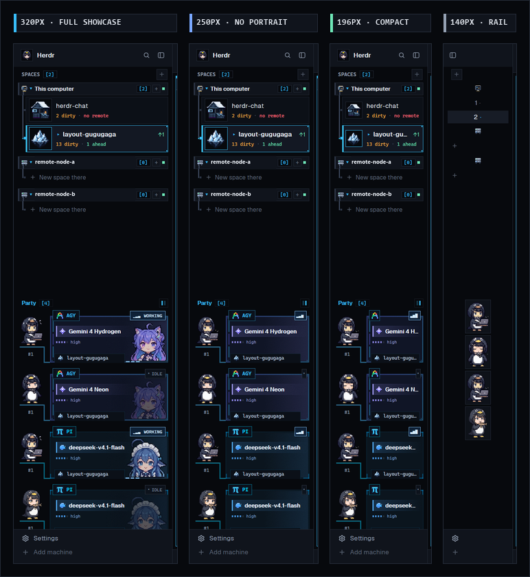

### 🃏 Party 展示卡总览与子代理树

| 多 CLI 皮肤 × 模型立绘 × 四态总览 (`Claude / Codex / OpenCode / Gemini / Qwen / Kimi`) | Hermes / 兜底企鹅 / Pi 与 2 层子代理树 |
| :---: | :---: |
|  | 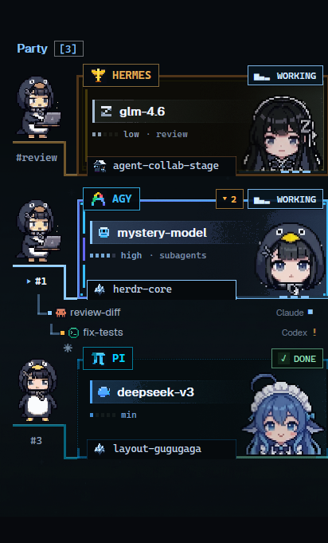 |

### 🐧 咕咕嘎嘎（`gugugaga`）7 组三态动图与头像池

| # | 像素头像 (`art/gugugaga`) | Rest 待机 (`~1.13 fps`) | Working 工作中 (`~6.25 fps`) | Blocked 等待确认 (`~3.12 fps`) |
| :---: | :---: | :---: | :---: | :---: |
| 1 | 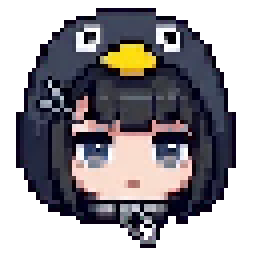 |  |  |  |
| 2 |  | 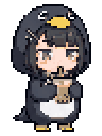 |  |  |
| 3 |  |  |  |  |
| 4 |  | 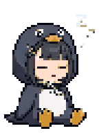 |  |  |
| 5 |  |  |  |  |
| 6 |  | 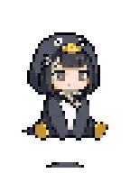 | 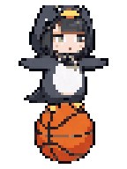 | 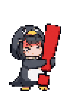 |
| 7 |  |  | 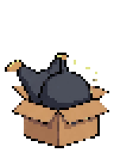 | 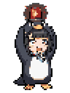 |

### 🏰 像素空间建筑 (`gugugaga-spaces`)

| 冰屋 (`igloo`) | 灯塔 (`lighthouse`) | 鱼铺 (`fishshop`) | 冰山 (`iceberg`) |
| :---: | :---: | :---: | :---: |
|  |  | 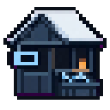 | 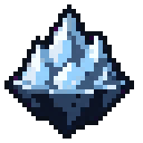 |

---

## 🚀 一键安装与切换

将仓库中的 `layouts`、`themes`、`mods` 复制到 Herdr 配置目录，并执行切换命令即可生效：

### Windows (PowerShell)

```powershell
$dest = "$env:USERPROFILE\.config\herdr-app"
New-Item -ItemType Directory -Force $dest | Out-Null
Copy-Item -Recurse -Force .\layouts, .\themes, .\mods $dest
herdr-app do layout.switch --name gugugaga
```

### macOS / Linux (Bash)

```bash
DEST="$HOME/.config/herdr-app"
mkdir -p "$DEST" && cp -R ./layouts ./themes ./mods "$DEST/"
herdr-app do layout.switch --name gugugaga
```

> **快捷键提示**：`Ctrl + Shift + L` 循环切换布局；`Ctrl + Alt + Shift + Esc` 随时切回默认 `main` 布局。

---

## 📅 更新内容 (Changelog)

### `2026-11-20`（Obsidian Pixel Deck 全局重构 + 分屏顶栏 + `gugugaga-files` 整合）
- **全局升级为「黑曜石像素机能台」**：新增 `themes/gugugaga-obsidian.json`（保留 `gugugaga-ice.json` 兼容），撤除 `sidebar-gugugaga.png` 雪花壁纸与泛蓝雪雾底色；全站 8 个 Mod 统一 `rounded(0)` 零圆角、中性炭灰树干/边框（`#232a36`）与 `Cascadia Mono` 全大写状态扣。
- **侧栏可拖拽与 4 档自适应收缩 (`gugugaga-agents` / `gugugaga-spaces`)**：开启 `sidebar.resizable: true`，修复 `on_size_change` 在 UI 缩放下未除 `settings().zoom` 的偏差；实现 `320 → 250（收起立绘）→ 196（仅露 layout…）→ <160（轨栏）` 四档平滑收缩，并新增 `Party [n]` 右侧 `320 ↔ 196` 一键切换扣；同步统一 `< 160` 窄轨阈值。
- **新增 28px 分屏终端机能顶栏 (`gugugaga-pane`)**：替换原生 `pane` 顶栏并切换 `work-body` 与 `pane` 为 `6px` 间隙、零圆角 `1px` 边框；支持 CLI/Blocked 顶条、聚焦态角钉、`t1xx` 地址微标签、紧凑目录与分支、`2×3` 非拦截拖拽握把、`↓N` 回底与悬停分屏按钮。
- **整合 `gugugaga-files`（原 `files-and-changes-addon`）与面板对齐**：将支持文件软换行、Diff 自动折行（带 `zoom` 修正与 `WRAP` 记忆开关）、`frame: "none"` 直角右键打开/定位菜单的面板整合进 `mods/gugugaga-files/`，并与 `mods/inbox/` 对齐 `h(36)` 顶栏与 `1px` 外框。
- **Tabs 与顶栏按键重构 (`gugugaga-tabs` / `gugugaga-chrome` / `gugugaga-toast`)**：右上角重构为 `+ | FILES · CHANGES · INBOX | - □ ×` 分区单色 SVG 按键组；重制 `1440×900` Bento 海报 `preview.png` 与全套脱敏实机预览图，新增 AI 入口索引文档 `AGENTS.md`。
- **Party 展示卡架构打底**：由旧版 64px 错位卡片升级为 `320px` 统一展示卡（10 套 CLI 边框皮肤 × 8 大模型半身立绘 × 3 层子代理树）。

### `2026-11-18`
- **独立为 `layout-gugugaga` 仓库**：精简剥离冗余资源，推出三态像素企鹅池（7 张 `256×256` 头像与 21 枚 `144×192` GIF）、`gugugaga-spaces` 4 座像素建筑、Windows/macOS 跨平台 `inbox`，以及最初版本的 `RECIPE.md` 与 `preview.png`。

---

## 🤖 AI 维护入口与仓库结构

面向 AI Agent 的详细常量锚点、设计铁律与已知陷阱已集中整理于 [**`AGENTS.md`**](AGENTS.md)，快速目录概览如下：

```text
layout-gugugaga/
├── AGENTS.md                        # AI 入口索引：模块锚点、色板铁律、联动清单与避坑
├── README.md                        # 中文说明（英文版：README.en.md）
├── RECIPE.md                        # Herdr 画廊重建说明书
├── preview.png                      # Herdr 画廊海报封面（1440×900）
├── layouts/
│   ├── gugugaga.json                # 主布局（8-Mod 槽位、6px 栅格、resizable 侧栏）
│   ├── gugugaga.png                 # 布局选择器纯净缩略图
│   ├── preview-gugugaga.png         # 全窗实机预览
│   ├── preview-shrink-tiers.png     # 320→250→196→140 四档收缩对比
│   ├── preview-party-cards.png      # 多 CLI × 模型立绘卡片总览
│   └── preview-party-subagents.png  # Hermes / 兜底企鹅 / 子代理树预览
├── themes/
│   ├── gugugaga-obsidian.json       # 当前默认：黑曜石像素机能台色板
│   └── gugugaga-ice.json            # 旧版冰夜主题（向后兼容保留）
└── mods/
    ├── gugugaga-chrome/             # 侧栏骨架、折叠切换与 30 枚单色 SVG
    ├── gugugaga-spaces/             # 机器大纲树、Git 轮询与自适应建筑槽
    ├── gugugaga-agents/             # 4 档自适应 Party 卡、10 CLI 皮肤、8 模型立绘与 3 层子代理树
    ├── gugugaga-tabs/               # 直角工作区 Tab 栏与分区 FILES/CHANGES/INBOX 控制组
    ├── gugugaga-pane/               # 28px 分屏终端机能顶栏
    ├── gugugaga-files/              # 软换行 Files & Changes + 右键打开/定位菜单（Apache-2.0 衍生）
    ├── gugugaga-toast/              # 直角角钉通知铭牌
    └── inbox/                       # 跨平台临时文件收件箱
```

校验全部 8 个 Mod 与运行时状态：

```powershell
foreach ($m in @("gugugaga-agents","gugugaga-spaces","gugugaga-tabs","gugugaga-toast","gugugaga-chrome","gugugaga-pane","gugugaga-files","inbox")) {
  herdr-app check "$env:USERPROFILE\.config\herdr-app\mods\$m"
}
herdr-app status
```

> 本地可选映射 `mods/gugugaga-agents/jobs.json` 与 `mods/gugugaga-spaces/places.json` 已在 `.gitignore` 中忽略，缺失时自动按名称哈希稳定分配。

---

## 🌐 在 Herdr 画廊分享

本仓库按 [herdr.dev/gallery](https://herdr.dev/gallery/?type=layouts) 的收录规范维护 `RECIPE.md`、`preview.png`（1440×900 Bento 海报）与 `layouts/gugugaga.png`。收录后条目地址为 `herdr.dev/layouts/Reidouleidoi/layout-gugugaga`，可通过一句话安装：

```text
Read ~/.config/herdr-app/AGENTS.md, then add this layout: herdr.dev/layouts/Reidouleidoi/layout-gugugaga
```

---

## 🙏 致谢与版权说明 (Credits)

1. **致谢 `herdr-traveler`**：本项目初始结构与像素旅人工作台理念衍生自 [@franky5440-afk](https://github.com/franky5440-afk) 创作的 [`herdr-traveler`](https://github.com/franky5440-afk/herdr-traveler)。因上游仓库未附带显式开源许可证（`LICENSE`），本仓库不擅自添加第三方总许可证文件，仅作个人与社区适配分享。
2. **Herdr 官方组件衍生（`Apache-2.0`）**：`mods/gugugaga-files/` 整合自本地衍生套件 `files-and-changes-addon`，其 `Files` 与 `Changes` 面板主体克隆自 [Herdr](https://herdr.dev) 0.1.16 内置模组（`Apache-2.0`），并保留原文件头部声明；`mods/gugugaga-pane/` 与 `mods/gugugaga-chrome/` 亦参考扩展自 Herdr 官方内置组件。
3. **原创视觉与主题改造**：`gugugaga` 全套三态企鹅与建筑像素资产、`themes/gugugaga-obsidian.json` 及 **Obsidian Pixel Deck** 全栈界面重构为本仓库原创适配内容。
