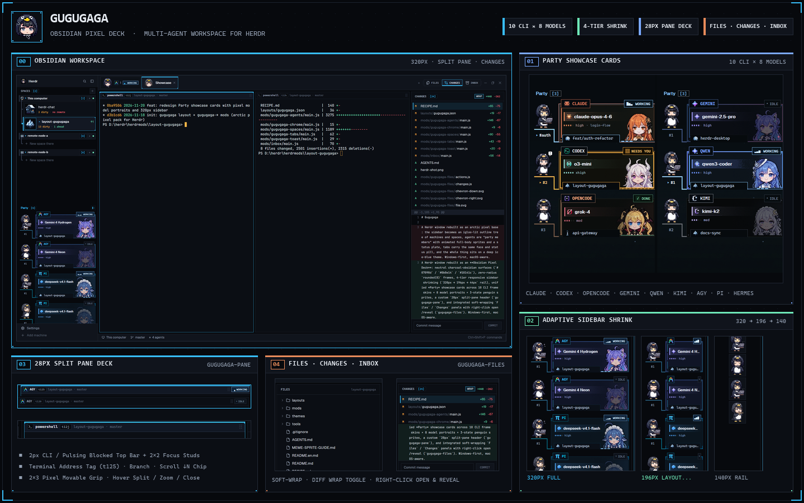

# Gugugaga

A Herdr window rebuilt as an **Obsidian Pixel Deck**: neutral charcoal-obsidian surfaces (`#07090d` / `#0b0e14` / `#10141c`), zero-radius `rounded(0)` frames, 4-tier responsive sidebar shrinking (`320px → 196px → 44px` rail), unified *Party* showcase cards across 10 CLI frame skins × 8 model portraits × 3-state penguin sprites, a custom `28px` split-pane header (`gugugaga-pane`), and integrated soft-wrapping `Files` / `Changes` panels with right-click open/reveal (`gugugaga-files`). Windows-first, macOS-aware.



## What you see

One row holding a resizable `320px` sidebar and the work column beside it. Inside the work column, top to bottom: the `58px` tab bar, the `work-body` row (`6px` padding, `6px` gap) holding split terminal panes and the collapsible right-hand side panel, and a `28px` status bar. Root background is canvas `#07090d` with `1px` `#232a36` dividers and `[12, 10]` terminal padding.

**Sidebar (320px wide, min 44, max 480, `resizable: true`).** Solid obsidian background (`#10141c` chrome / `#07090d` canvas, no background wallpaper).

- **Brand strip, 46px:** a 20px pixel face (`mods/gugugaga-agents/art/gugugaga/a1.png`) inside a `24×24` `rounded(0)` dark slot, the "Herdr" wordmark in 13.5px semibold, then two 26px `rounded(0)` icon buttons: search (opens the picker) and sidebar toggle.
- **Spaces (upper half of the list area, weight 1, min 90):** a sharp pixel outliner, headed by `SPACES` in `Cascadia Mono` 10.5px bold + `[n]` count chip and a `22×22` `+` button. Each machine is a `26px` `rounded(0)` row (`#10141c`, `1px` `#232a36` border): a `2px` charcoal bar, `▸`/`▾`, `13px` device icon (`device-local.svg` / `device-remote.svg`), machine name, `[n]` chip, `+` button (hidden when `blockW < 230`), and a `5×5` status square. Spaces hang under neutral charcoal (`#3a4559`) trunk lines; only the active space's branch and `7×7` node light up in `accent` (`#38bdf8`). Each space shows a pixel landmark (`igloo`, `lighthouse`, `fishshop`, `iceberg`) inside a `46×46` (`34×34` when `blockW < 230`) `rounded(0)` `#07090d` slot, its flex-1 truncated name, git branch, and dirty/ahead counts in `Cascadia Mono`.
- **Party, the agents list (lower half, weight 1, min 90):** a header `Party` + `[n]` chip and a `18×18` `[||]` quick-shrink toggle (`320px ↔ 196px`), then `109px` showcase cards (`CARD_STEP` `117px`). Each card pairs a `56px` left sprite lane (`48×64` penguin on a `2px` `━━┓┗━━` step rail above a frameless `#Tab` label) with a responsive `rounded(0)` pixel nameplate (`PLATE_TOP` `11px`, `plateW = clamp(round(panelW - 16 - 64), 80, 320)` using `panelW = size.width / zoom`):
  - `panelW >= 272`: Full showcase with `112×90` model portrait + dynamically right-anchored `fadeLayer`.
  - `228 <= panelW < 272`: Portrait & scrim cleanly collapsed; keeps subtle `modelBacking` glow.
  - `160 <= panelW < 228`: Compact nameplate down to `layout…` (`notchW` shrinks to `56..142`), icon-only status clasp below `plateW < 192`, logo-only CLI clasp below `plateW < 156` (or `< 176` with squad chip), adaptive bottom track (`>= 24px`).
  - `panelW < 160`: Switches to `52×68` pixel rail cards.
- **Footer, 69px:** two `rounded(0)` rows on solid chrome with a `1px` top border — Settings (with a `6×6` square dot when an update is ready) and Add machine.

**Work column.**

- **Tab bar, 58px:** `48px` `rounded(0)` cards with a `2px` top semantic strip (CLI color when active, amber when blocked) + bottom `2×2` corner studs, `40×40` character portrait, `16×16` CLI slot, tab name, and `Cascadia Mono` uppercase status pill (`WORKING` / `NEEDS YOU` / `DONE` / `IDLE`). To their right, partitioned by `1px × 16px` vertical dividers: `+`, `FILES` / `CHANGES` / `INBOX` (`26px` `rounded(0)` buttons using `14×14` monochrome SVGs from `gugugaga-chrome` + active bottom bar), and Windows min/max/close buttons.
- **Split terminal panes:** `6px` padding and `6px` gap; every pane is a sharp `radius: 0` card (`1px` `#232a36` border, `1px` `accent` when focused) topped by a `28px` `gugugaga-pane` header: `2px` top bar (`blocked` pulsing amber > `focused` CLI color) + `2×2` corner studs when focused, `16×16` CLI badge, short name + terminal address chip (`t125`), last directory + optional branch (`paneW >= 360`), `2×3` pixel grip when `movable`, `↓N` scroll-bottom badge, `STATUS_SKIN` pill (icon-only when `< 280px`), `[Z]` zoom tag, and `20×20` hover split/zoom/close buttons.
- **Side panel, 368px (min 280, max 900, hidden until toggled):** `panel-body` stack of `Files`, `Changes` (`gugugaga-files`), and `Inbox` (`inbox`), all sharing `1px` `#232a36` outer borders and `36px` `Cascadia Mono` headers.

**Status bar, 28px:** Herdr's built-in `workspace-status`, restyled by `gugugaga-obsidian`.

**Colors** come from `themes/gugugaga-obsidian.json`: canvas `#07090d`, terminal background `#0b0e14`, chrome/surface/popover `#10141c`, raised/input `#171c26`, border `#232a36`, text `#e6ebf2` with muted `#94a0b2` and dim `#5c6676`, accent `#38bdf8`, solid/blocked `#ffb547`, selection `#1d2d44`, selected `#38bdf81c`. Status colors: working `#38bdf8`, blocked `#ffb547`, done `#6ee7b7`, idle `#525d6e`. Legacy `themes/gugugaga-ice.json` remains in `themes/` for backward compatibility.

## How it behaves

Four states drive everything — sprite, card badge, tab pill, pane top bar, squad chip, and toast:

| state | sprite | tab / pane mark | color |
| --- | --- | --- | --- |
| working | `sprites/gugugaga/w/*.gif`, 4 frames at 160ms | `▘▝▗▖` cycling every 140ms | accent `#38bdf8` |
| blocked | `b/*.gif`, 4 frames at 320ms | `!` blinking | amber `#ffb547` |
| done | `r/*.gif` | `✓` | green `#6ee7b7` |
| idle | `r/*.gif`, 4 frames (~3.5s loop) | `▪` | dim `#525d6e` |

- **Clicks, shrink & drag-reorder.** Left-click focuses (`agent.focus`); dragging reorders Party cards (`localStorage["agents.order"]`). Dragging the sidebar edge resizes continuously across all 4 tiers, and `[||]` snaps between `320px` and `196px`. Subagent rows focus (`pane.focus`) or peek (`terminal.peek`); squad chips (`▾`/`▸` + count) fold children and take the most urgent child's color.
- **Spaces & Tabs.** Spaces select, drag-reorder (`space.move`), and open `menu`. Tabs select, drag-reorder (`tab.move`), double-click rename, right-click menu, and remember the active side panel per space in `localStorage["panels"]`.
- **Files & Changes (`gugugaga-files`).** Derived from Herdr 0.1.16 (`Apache-2.0`) + `files-and-changes-addon`: `Files` previews text with `soft_wrap: true`; `Changes` wraps virtual diff rows by zoom-adjusted container width (`localStorage["gugugaga-files/wrap"]`, falling back to `files-and-changes-addon/wrap`) and stages/commits via `git`; right-clicking any local item opens a `frame: "none"` `rounded(0)` popup (`Open with default app` / `Open folder` / `Reveal in File Explorer`, navigable via `↑/↓/Enter/Esc`).
- **Inbox (`inbox`).** Lists `data/inbox/files`; click opens with default app, right-click copies safely to Desktop or moves to OS Trash/Recycle Bin.
- **Toast (`gugugaga-toast`).** `rounded(0)` pixel nameplate with `2px` top bar, corner studs, uppercase status badge, and one-click `hc machine login` command copy.

## Built from

`layouts/gugugaga.json` is Herdr's `main` layout (`cloned_from: main 0.1.11`) rebuilt with 8 custom mods:

```
root  row  (background canvas #07090d, terminal_padding [12, 10], divider 1px border,
            titlebar none, traffic_lights [12, 16],
            toast "gugugaga-toast", theme "gugugaga-obsidian", terminal_opacity 1)
├─ sidebar  column  320px, min 44, max 480, resizable true
│  ├─ brand          block {mod: gugugaga-chrome}                    46px, window_drag
│  ├─ sidebar-lists  column
│  │  ├─ spaces      block {mod: gugugaga-spaces}                    weight 1, min 90
│  │  └─ agents      block {mod: gugugaga-agents}                    weight 1, min 90
│  └─ sidebar-footer block {mod: gugugaga-chrome, props {footer:true}} 69px
└─ work  column
   ├─ tabs           block {mod: gugugaga-tabs}                      58px, window_drag
   ├─ work-body      row  padding 6, gap 6
   │  ├─ main        block {tab: active, pane {header {content {mod: gugugaga-pane},
   │  │                     reveal always, height 28, position top},
   │  │                     border 1 #232a36, focus 1 accent, radius 0, gap 6, lone true}}
   │  └─ panel       column 368px, min 280, max 900, hidden
   │     └─ panel-body stack active files
   │        ├─ files    block {mod: gugugaga-files, props {panel: "files"}}
   │        ├─ changes  block {mod: gugugaga-files, props {panel: "changes"}}
   │        └─ inbox    block {mod: inbox}
   └─ status         block {mod: workspace-status}                   28px
```

Keep `toast`, `theme`, and `preview` at root. All 8 mods live under `mods/`:
- **`gugugaga-chrome`** — brand strip, footer, sidebar width toggle, 30 monochrome SVGs.
- **`gugugaga-spaces`** — machine/space outliner, git status polling, responsive building tiles (`34px` / `46px`).
- **`gugugaga-agents`** — 4-tier responsive Party showcase cards, `lib.js` CLI skins & model portraits, 3-level subagent tree.
- **`gugugaga-tabs`** — `rounded(0)` tab strip, partitioned `FILES`/`CHANGES`/`INBOX` monochrome SVG buttons, window buttons.
- **`gugugaga-pane`** — `28px` custom split-pane header with CLI bar, corner studs, terminal address badge, movable grip, scroll-bottom, zoom tag, and hover split/zoom/close buttons.
- **`gugugaga-files`** — soft-wrapping `Files` & `Changes` panels + keyboard-navigable `frame: "none"` right-click popup (derived from Herdr 0.1.16 `Apache-2.0` + `files-and-changes-addon`).
- **`gugugaga-toast`** — `rounded(0)` pixel notification nameplate overlay.
- **`inbox`** — `rounded(0)` cross-platform file inbox over `data/inbox/files`.

## Watch out

- **`on_size_change` reports scaled pixels**: divide `size.width` by `settings().zoom || 1` before applying layout breakpoints (`gugugaga-agents`, `gugugaga-spaces`, `gugugaga-pane`, `gugugaga-files/changes.js`).
- **Sidebar collapsed by width (`< 160px`)**: `gugugaga-agents`, `gugugaga-spaces`, and `gugugaga-chrome` must share the `< 160` threshold. On macOS, collapsing to `76px` hides the chrome collapse button in the traffic-light row, though `resizable: true` allows dragging the sidebar edge back out.
- **Keep `#ffb547` exclusive to `blocked`**: normal active states, toggles, and `COMMIT` buttons use `#38bdf8` (`accent`) so blocked alerts never blend in.
- **`jobs.json` and `places.json` are local untracked overrides**: mods fall back deterministically by name hash when absent.
- **Four `lib.js` copies**: `gugugaga-agents`, `gugugaga-tabs`, `gugugaga-toast`, and `gugugaga-pane` carry independent copies (mods do not cross-import across directories).
- **Pixel art integer ratios**: keep `sprites` (`48×64` from `144×192`) and `models` (`112×90` from `224×180`) un-squished.
- **Side panel starts hidden**: press `FILES`, `CHANGES`, or `INBOX` in the tab bar to open it.
